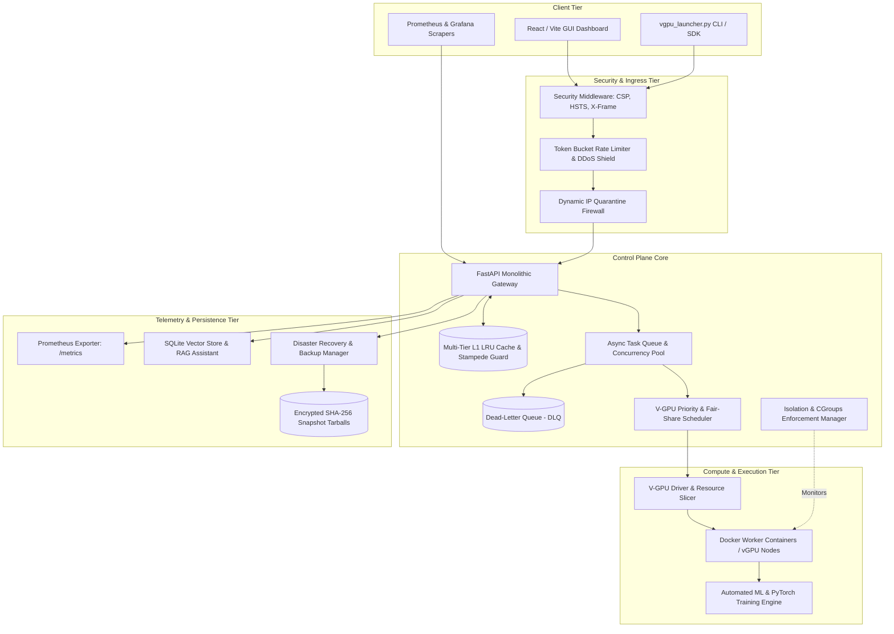
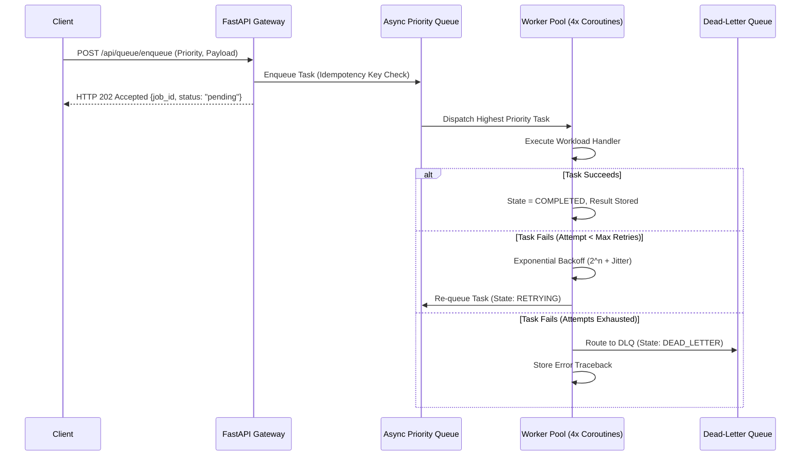

# V-GPU Production System Design Document (HLD & LLD)

```
========================================================================================
 Project:        V-GPU: High-Performance GPU Virtualization & Orchestration Platform
 Document Type:  High-Level Design (HLD) & Low-Level Design (LLD)
 Target Env:     Production-Grade Linux/Kubernetes & Edge Deployment
 Version:        2.0.0-PROD
========================================================================================
```

---

## 1. Executive Summary & Architectural Goals

The **V-GPU Platform** is a virtualized GPU compute orchestration platform designed to slice physical GPU hardware (or high-fidelity GPU simulators) into hardware-isolated virtual GPU instances (vGPUs). It provides strict compute and VRAM boundaries, intelligent workload scheduling, multi-tier caching, asynchronous resilient message queues, zero-trust network protection, and cryptographic disaster recovery backups.

### Primary Architectural Pillars:
1. **Compute Virtualization & Isolation**: Sub-allocating VRAM (MB) and compute time-slices across multiple isolated containerized worker nodes with strict cgroup limits.
2. **Multi-Tier Caching Layer**: Ultra-fast L1 In-Memory LRU cache with fine-grained TTL, single-flight stampede protection, and tag-based group invalidation.
3. **Resilient Asynchronous Task Queue**: Prioritized job distribution, exponential backoff retries with jitter, and Dead-Letter Queue (DLQ) quarantine for poison messages.
4. **Defense-in-Depth Security**: Token-bucket sliding-window rate limiting, dynamic IP quarantine firewall, path-traversal mitigation, and OWASP HTTP security headers.
5. **Disaster Recovery & Point-in-Time Restore**: Compressed, cryptographic SHA-256 verified snapshot backups with atomic rollback capabilities.
6. **Unified Observability**: End-to-end telemetry via Prometheus metrics exposition and auto-provisioned Grafana operational dashboards.

---

## 2. High-Level Architecture (HLD)

The platform follows a modular, high-cohesion architecture separating ingress traffic, core orchestration, compute execution, telemetry, and persistence.



---

## 3. Subsystem Low-Level Design (LLD)

### 3.1 Multi-Tier Caching Architecture (`core/cache/tier_cache.py`)

To achieve low-latency read performance for cluster snapshots, hardware telemetry, and AI token analytics, V-GPU implements a thread-safe L1 memory LRU cache with fine-grained TTL.

```
Incoming Request ----> Hash Key (SHA-256)
                           |
                     [ In Cache? ]
                     /           \
                 (YES)           (NO)
                 /                  \
          [ Expired? ]         Acquire Key Mutex
          /          \               |
       (NO)          (YES)     [ In Cache Now? ] (Double-Check)
        |              |        /             \
   Return Cached    Purge Key  (YES)          (NO)
   (Record Hit)     (Miss)      |               |
                           Return Cached   Compute / Fetch
                                           (Single-Flight)
                                                |
                                           Store with TTL & Tags
                                                |
                                           Return Fresh Value
```

- **LRU Eviction**: Maintains an `OrderedDict` limited to 3,000 keys. Evicts expired keys first, followed by the oldest accessed item.
- **Single-Flight Stampede Protection**: Uses an async mutex per cache key (`_async_locks`). When 50 concurrent requests query an expired key, only **one** coroutine computes the value; the remaining 49 await the mutex and receive the cached result.
- **Tag Invalidation**: Keys are tagged by domain (e.g., `metrics`, `vgpu`, `ai`). When an instance is modified or a job completes, `system_cache.invalidate_by_tag('vgpu')` purges affected entries in $O(k)$ time.

### 3.2 Asynchronous Task Queue & Dead-Letter Queue (`core/queue/async_queue.py`)

Heavy compute tasks (model training, benchmark comparisons, and snapshot generation) are handled asynchronously outside the HTTP request-response cycle.



- **Priority Hierarchy**: `CRITICAL` (0), `HIGH` (1), `NORMAL` (2), `LOW` (3).
- **Idempotency Protection**: Inbound requests include an optional `idempotency_key`. Duplicate requests while a job is pending or running immediately return the existing job ID.
- **Jittered Backoff Formula**:
  $$t_{\text{wait}} = \min\left(t_{\text{max}}, t_{\text{initial}} \times 2^{\text{attempt}-1}\right) + \text{Uniform}(0.1, 0.5)$$
- **Dead-Letter Replay**: Operators can inspect poison messages via `GET /api/queue/jobs/{id}` and trigger `POST /api/queue/jobs/{id}/replay` to re-enter the processing queue once upstream issues are resolved.

### 3.3 Defense-in-Depth Security & Rate Limiting (`core/security/security_middleware.py`)

The security layer provides network-level and HTTP-level protection before requests reach application logic.

1. **OWASP Hardened Headers**:
   - `Content-Security-Policy`: Restricts resource execution to trusted origins and strictly controls iframe embedding.
   - `Strict-Transport-Security (HSTS)`: `max-age=31536000; includeSubDomains`.
   - `X-Content-Type-Options: nosniff`: Prevents MIME-type sniffing.
   - `X-Frame-Options: SAMEORIGIN`: Prevents clickjacking.
   - `Permissions-Policy`: Disables camera, microphone, and geolocation.
2. **Adaptive Token Bucket Rate Limiter**:
   - Capacity: 60 burst tokens.
   - Refill Rate: 180 requests/minute (3 tokens/second).
   - If depleted, requests receive `HTTP 429 Too Many Requests` with `Retry-After: <seconds>`.
3. **Automated Flood Defense (Auto-Ban)**:
   - Tracks violations per client IP in a 30-second sliding window.
   - If $\ge 8$ rate-limit violations occur in 30 seconds, the IP is automatically quarantined for 300 seconds (5 minutes).
4. **Tamper-Evident Audit Logging**:
   - Records all administrative interventions, backup restorations, and rate-limit violations with client IP, timestamp, and severity rating (`INFO`, `WARNING`, `CRITICAL`).

### 3.4 Disaster Recovery & Backup Engine (`core/backup/backup_manager.py`)

Ensures business continuity and fast recovery from hardware failures, database corruption, or operator errors.

- **Snapshot Targets**: SQLite databases (`data/chatbot_index.db`, `data/chatbot_history.db`), uploaded datasets, telemetry configuration, and monitoring definitions.
- **Cryptographic Manifest**: Each `.tar.gz` archive is paired with a `.json` manifest containing the SHA-256 hash, file list, creation duration, and byte size.
- **Automated Retention**: Limits retained backups to the 10 newest snapshots, pruning older archives automatically to prevent disk saturation.
- **Point-in-Time Restore**: Verifies the archive's SHA-256 checksum prior to decompression. Automatically aborts and preserves existing state if corruption or tampering is detected.

---

## 4. REST API Specifications

| Method | Endpoint | Description | Auth / Scope |
| :--- | :--- | :--- | :--- |
| `GET` | `/api/cache/stats` | Retrieve cache hit/miss ratio, size, active tags | Public / Read |
| `POST` | `/api/cache/clear` | Purge entire cache or invalidate by specific tag | Operator / Admin |
| `POST` | `/api/queue/enqueue` | Enqueue background async task with priority | Operator / Admin |
| `GET` | `/api/queue/stats` | Inspect worker pool utilization, queue depth, DLQ size | Operator / Read |
| `GET` | `/api/queue/jobs/{id}` | Inspect progress, results, and retry logs for a task | Operator / Read |
| `POST` | `/api/queue/jobs/{id}/replay` | Replay poisoned task from Dead-Letter Queue | Admin |
| `DELETE`| `/api/queue/jobs/{id}` | Abort / Cancel a pending or running task | Operator / Admin |
| `GET` | `/api/security/status` | Read rate limiter metrics and quarantined IP list | Admin / Read |
| `GET` | `/api/security/audit-logs` | Retrieve chronological security audit events | Admin / Read |
| `POST` | `/api/security/block-ip` | Manually quarantine an abusive client IP | Admin |
| `POST` | `/api/security/unblock-ip` | Release an IP from quarantine | Admin |
| `POST` | `/api/backup/create` | Trigger full cryptographic SHA-256 snapshot | Admin |
| `GET` | `/api/backup/list` | List all historical disaster recovery archives | Admin / Read |
| `POST` | `/api/backup/{id}/verify` | Cryptographically verify snapshot SHA-256 hash | Admin |
| `POST` | `/api/backup/{id}/restore` | Perform atomic point-in-time recovery | Admin |
| `DELETE`| `/api/backup/{id}` | Delete a designated backup archive | Admin |
